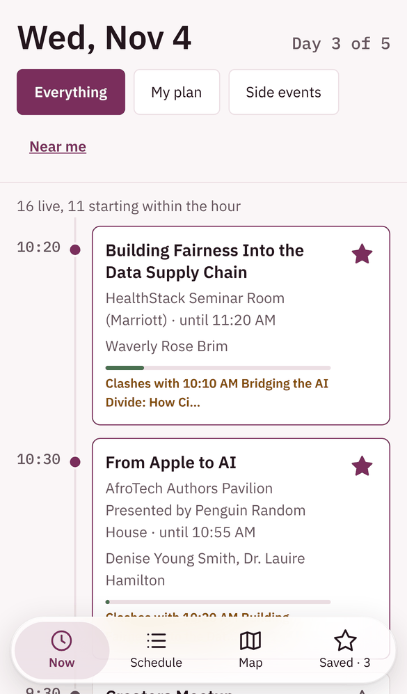
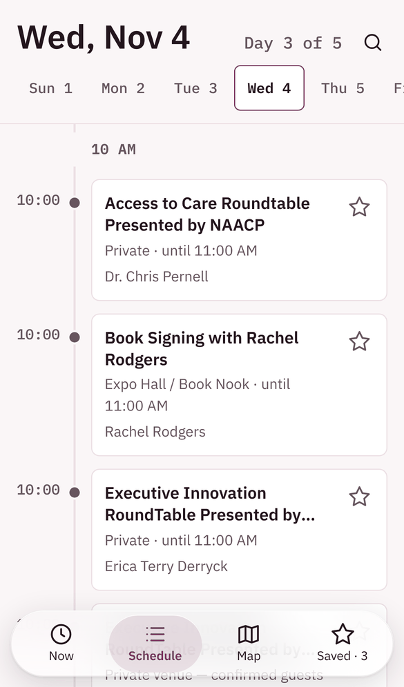
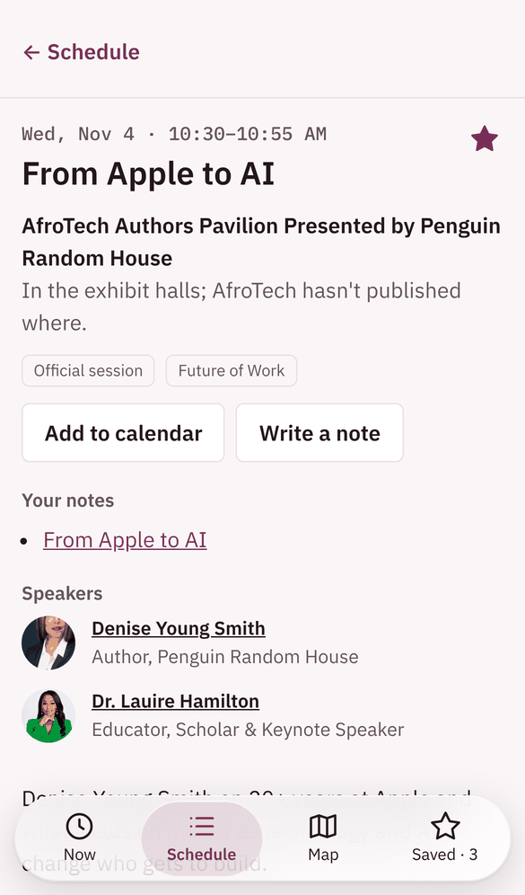
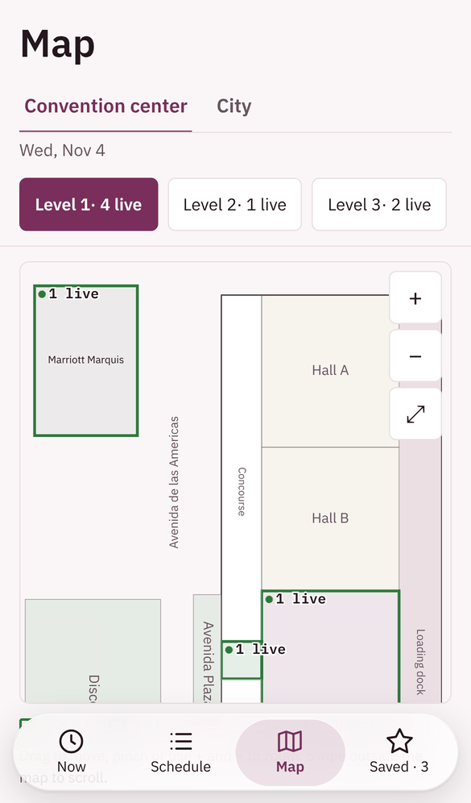
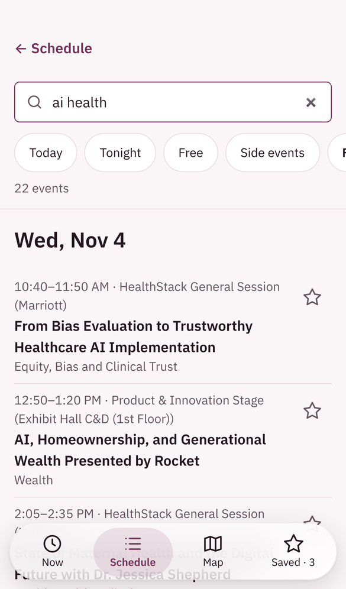
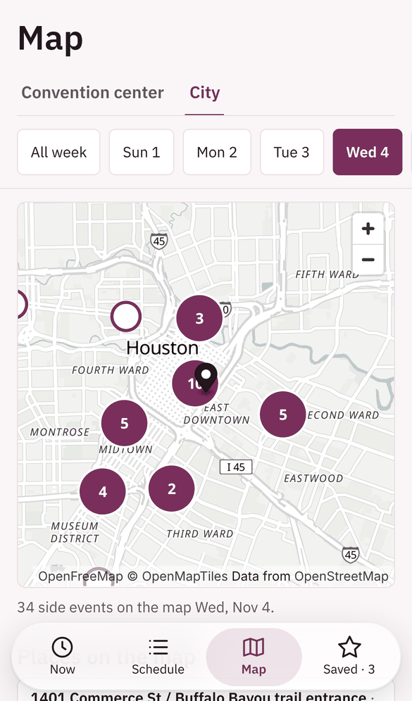
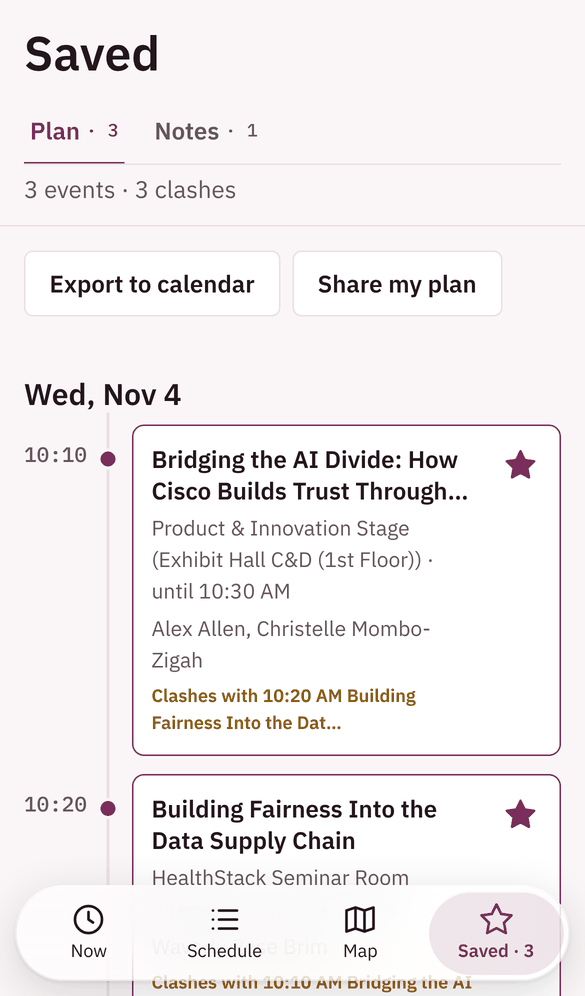
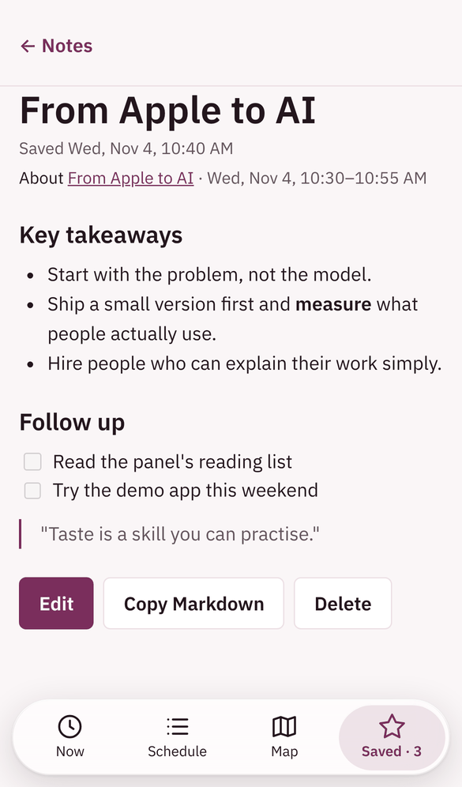

# AfroTech 2026 Planner

> [!NOTE]
> **This project is finished.** AfroTech 2026 ended on November 6, 2026, and
> this repository is archived. It no longer takes issues or pull requests, and
> the event data no longer refreshes. The code and data stay here as a record
> of the week.

**Live at [afrotech26.laudebugs.me](https://afrotech26.laudebugs.me)** · November 2–6, 2026 · George R. Brown Convention Center, Houston

AfroTech 2026 ran 263 official sessions and about 180 community side events
over five days. The sessions sat on the conference website, while the side
events were spread across shared spreadsheets and RSVP pages. To plan a day,
you jumped between them, guessed which room was where, and lost track of what
you'd starred. This planner merges both into one mobile site, so you can see
what's on now, build your week, find any room, and keep private notes, even
on the convention center's patchy Wi-Fi.

<p align="center">
  <picture><source media="(prefers-color-scheme: dark)" srcset="docs/screenshots/dark/now.png"></picture>
  <picture><source media="(prefers-color-scheme: dark)" srcset="docs/screenshots/dark/schedule.png"></picture>
  <picture><source media="(prefers-color-scheme: dark)" srcset="docs/screenshots/dark/event.png"></picture>
  <picture><source media="(prefers-color-scheme: dark)" srcset="docs/screenshots/dark/map.png"></picture>
</p>

## One place for the whole week, official and unofficial

The site answers the questions people ask most during the conference:

| Question | Where the answer is |
|----------|---------------------|
| What's on right now? | **Now** shows live sessions and those starting within the hour on a timeline, and warns when two starred events clash. |
| What's on Thursday afternoon? | **Schedule** lists each day, official sessions and side events together, with filters for track, type, cost, access and time of day. |
| Where's that AI panel with the Google speaker? | **Search** covers every event, speaker and your own notes across the week. It forgives typos, and any search can be shared as a link. |
| Where's Room 320? | **Map** shows a traced floor plan of the convention center, level by level, with live sessions on each room. A city map pins the side events across Houston. |
| How do I get there? | **Directions** opens Apple Maps, Google Maps or Waze, whichever you choose. |

<p align="center">
  <picture><source media="(prefers-color-scheme: dark)" srcset="docs/screenshots/dark/search.png"></picture>
  <picture><source media="(prefers-color-scheme: dark)" srcset="docs/screenshots/dark/city.png"></picture>
  <picture><source media="(prefers-color-scheme: dark)" srcset="docs/screenshots/dark/saved.png"></picture>
  <picture><source media="(prefers-color-scheme: dark)" srcset="docs/screenshots/dark/note.png"></picture>
</p>

## Your plan and notes stay yours

Star any event to add it to **Saved**. Your plan exports to your calendar, and
a link shares it with a friend. Each session also takes a note: write in
Markdown, add photos, and tick off follow-ups. Notes are private, and only
you can read them.

Everything works without an account. Your plan and notes save on your device,
and the site sends no requests about you. Signing in with Google is optional:
it syncs your plan and notes across your phone and laptop. **Delete my data**
removes them from the server at once.

## Built for the convention floor

- **Offline:** a service worker saves the schedule, the maps and your starred events, so the site keeps working when the Wi-Fi drops.
- **Installable:** add it to your home screen and it opens like an app, with a glass tab bar and iOS-style page transitions.
- **Fresh:** a GitHub Action re-pulls the official schedule and the community lists every two hours during the week. It also checks each side event against its own page, so names, times and places match what the organiser published.
- **Readable anywhere:** times are always Houston time, there's a dark mode, and every page fits a phone first.

The site is an Astro static site on Cloudflare, with a small Worker and a D1
database for sign-in and sync. The rest of this README covers running and
deploying it.

## Website

The planner site lives at **https://afrotech26.laudebugs.me**. It's an Astro
site in this repo that Cloudflare builds and deploys on every push.

```bash
npm install
```

```bash
npm run dev       # local dev server at http://localhost:4321
```

```bash
npm run preview   # build, then serve it the way Cloudflare does
```

`npm run build` type-checks the site and the Worker (`worker/`, which answers
`/api/*`) and builds into `dist/`. `npm run preview` also applies the database
migrations to a local D1, so sign-in code runs offline too. `npm run deploy` deploys
by hand, after a one-time `npx wrangler login`; normally Cloudflare deploys on
push. Node 22.23.4 or later is
required (`.node-version` pins it for Cloudflare).

### Cloudflare setup (one time)

In the Cloudflare dashboard, open **Workers & Pages → Create → Import a
repository**, choose `laudebugs/afrotech` and use these settings:

| Setting | Value |
|---------|-------|
| Project name | `afrotech2026` (must match `name` in `wrangler.jsonc`) |
| Production branch | `main` |
| Build command | `npm run build` |
| Deploy command | `npx wrangler d1 migrations apply afrotech --remote && npx wrangler deploy` |

The deploy command first brings the D1 database (`afrotech`) up to date with
`worker/migrations/`, then deploys. Keep migrations out of the branch-build
command: preview builds share the live database, so only `main` may change it.
If the migration step fails with a permissions error, give the build's API
token **D1: Edit** under **Manage account → API tokens**.

Every push to `main` then goes live. For preview URLs on other branches, also
turn on **Builds for non-production branches** in the project's Build
settings.
`wrangler.jsonc` attaches the custom domain, so Cloudflare creates its DNS
record and certificate on the first deploy.

## Docs

- [Plan: events site](docs/plans/0001-events-site.md) — what we're building and why
- [Plan: optional Google sign-in](docs/plans/0002-google-sign-in.md) — sync My plan across devices
- [Plan: speaker profiles](docs/plans/0003-speaker-profiles.md) — bios, sourced fun facts and links
- [Plan: offline support](docs/plans/0004-offline-support.md) — keep working on dead convention Wi-Fi
- [Plans 0005–0011](docs/plans/) — private notes, the Saved tab, event pages and maps apps, search, the glass tab bar, the admin dashboard
- [To-dos](docs/todos/README.md) — tasks, one file each
- [Design language](docs/design/design-language.md)
- [Research: interactive SVG floor plan](docs/research/svg-floor-plan.md)
- [Research: speaker profile sources](reports/Speaker%20profile%20research%20sources.md) — how to gather speaker info safely
- [Sources](docs/sources.md) — where every bit of data comes from

## Layout

| Path | What's in it |
|------|--------------|
| [`schedule/official.md`](schedule/official.md) | Full official agenda, by day (263 sessions, Houston time) |
| [`schedule/side-events.md`](schedule/side-events.md) | About 180 side events (parties, mixers, dinners, workshops) with RSVP links and founder/investor picks |
| [`data/sessions.csv`](data/sessions.csv) / [`.json`](data/sessions.json) | Official agenda as data, with descriptions, ticket levels and calendar links |
| [`data/side-events.csv`](data/side-events.csv) | Side events as data, with addresses and descriptions |
| [`scripts/`](scripts/) | Re-pull the official agenda and side events |

## Taking notes

Open any session on the site and tap **Write a note**. Notes save on your
device as you type, and only you can see them. Sign in with Google on the
**Saved** tab to keep them on all your devices. **Share** and **Copy Markdown** on a
note pass it on.

## Refreshing the schedules

```bash
python3 scripts/update_schedule.py
```

```bash
python3 scripts/update_side_events.py
```

No dependencies beyond Python 3.9+.

## Sources

- Official schedule: https://afrotechconference.com/schedule
- AfroTech Guide: https://afrotech.guide/
- Side events (Google Sheet): https://docs.google.com/spreadsheets/d/1PLDLOdFCuwDAy4fe5y09hb4KgYlX3bsgX60U2z2KE_0/edit
- Side events (Adaptive Foundation, OneDrive — saved in `data/sources/` since OneDrive blocks automated downloads): https://1drv.ms/x/c/201780541da98428/IQAwneocjcw7RLgXigZPaCX-Afj6iRzSioL8HrnOZ6uMc-Y
